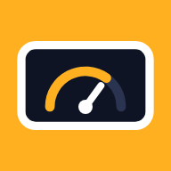

<p align="center"></p>

<h1 align="center">폰대시 (PhoneDash)</h1>

<p align="center"><b>안드로이드 공기계를 컴퓨터 옆 대시보드로.</b><br>
CPU·GPU·메모리, 재생 중인 음악, Claude·Codex 사용량, 바로가기 버튼을 QR 한 번 찍고 공기계에 띄웁니다.</p>

폰대시는 두 부분으로 이루어져 있습니다.

| | 어디서 받나 | 하는 일 |
|---|---|---|
| **공기계 앱** | Google Play (무료, Pro는 한 번 결제하는 인앱 상품, `kr.phonedash.app`) | 전체 화면 대시보드. Android 7.0 이상 |
| **PC 프로그램** | 폰대시 사이트의 `PhoneDash-Setup.exe` (무료, Windows) | PC 정보를 읽어 Wi-Fi(또는 USB)로 공기계에 보냄, 브라우저 설정 화면 |

## 사용자는 이렇게 씁니다

1. 컴퓨터에서 폰대시 사이트에 들어가 `PhoneDash-Setup.exe`를 받아 실행합니다. 설치 폴더를 고를 필요 없이 바로 설치되고,
   컴퓨터를 켤 때마다 자동으로 켜지며, 설정 화면과 함께 연결용 QR 코드가 뜹니다(Wi-Fi 연결이 기본으로 켜져 있음).
2. 공기계에서 Google Play로 폰대시를 삽니다.
3. 같은 Wi-Fi에서 공기계 카메라로 QR을 찍고, 확인 코드를 맞춰 [페어링]을 누르면 끝입니다. 개발자 옵션은 필요 없습니다.
   케이블로 쓰려면(충전 겸용, PC를 켜면 화면도 켜짐) 개발자 옵션에서 USB 디버깅을 켜고 USB로 연결합니다.

## 개발

| 도구 | 버전 |
|---|---|
| PC 프로그램 | .NET 10 (`agent/PhoneBox.Agent`, 테스트는 `agent/PhoneBox.Agent.Tests`) |
| 폰 앱 | JDK 17, Android SDK 36, Kotlin + WebView (`android/`, 화면은 `android/app/src/main/assets/www`) |
| 사이트·검사 스크립트 | Node.js 22 이상 |

```powershell
# PC 프로그램 테스트 / 설치 없이 실행
dotnet test agent/PhoneBox.Agent.Tests
dotnet run --project agent/PhoneBox.Agent -- --portable

# 폰 앱 디버그 빌드 (페어링 주소는 phonedash.invalid: 남의 사이트로 연결되지 않음)
cd android; .\gradlew.bat assembleDebug testDebugUnitTest

# 사이트(안내·다운로드·개인정보처리방침·페어링 페이지·데모) 만들기와 미리보기
node tools/pages/build-site.mjs
node tools/ui-tests/serve.mjs dist/site 8899   # http://127.0.0.1:8899/phonedash/

# 메타데이터·번역 검사, 화면 테스트
node tools/check-release.mjs
cd tools/ui-tests; npm ci; npx playwright test
```

## 출시

1. 처음 한 번: `node tools/set-owner.mjs <GitHub 사용자 이름>`. 사이트 주소
   (`https://<이름>.github.io/phonedash/`), Wi-Fi 페어링 링크, PC 프로그램 업데이트 저장소(`<이름>/phonedash`)가 함께 정해집니다.
2. 버전 올리기: `agent/PhoneBox.Agent/PhoneBox.Agent.csproj`의 `<Version>`, `android/app/build.gradle.kts`의
   `versionName`과 `versionCode`(매번 +1), `CHANGELOG.md`에 `## x.y.z — YYYY-MM-DD` 항목.
3. `node tools/release.mjs`: 검사와 테스트 후 `dist/`에 Play용 AAB, `PhoneDash-Setup.exe`, 업데이트용 zip,
   `SHA256SUMS`, 사이트를 만들고 올리는 명령을 알려 줍니다. 올리는 일(Play Console, GitHub Releases, Pages)은 직접 합니다.

Play 업로드 키는 저장소 밖 `~/.phonedash/`(`upload-key.jks`, `signing.properties`)에 있습니다. **잃어버리면 앱을 업데이트할 수
없으니** 따로 백업해 두세요(Play App Signing을 쓰면 Google에 재설정을 요청할 수는 있습니다).

## 개인정보

폰대시는 계정·자체 서버·광고가 없고, 이용 통계는 폰 앱에서 동의한 경우에만 보냅니다(Google 애널리틱스). 밖으로 나가는 요청의 전체 목록은 [PRIVACY.md](PRIVACY.md)에 있습니다.

## 라이선스와 원작

폰대시는 Ersin KOÇ의 오픈소스 프로젝트 [PhoneBox](https://github.com/ersinkoc/phonebox)(MIT 라이선스)를 바탕으로 만들었습니다.
원작의 저작권 표시와 라이선스 전문은 [LICENSE](LICENSE)에, 함께 쓰는 오픈소스 목록은
[THIRD-PARTY-NOTICES.txt](agent/PhoneBox.Agent/THIRD-PARTY-NOTICES.txt)에 있으며, PC 프로그램의 `/licenses` 페이지에서도 볼 수 있습니다.

---

**PhoneDash** turns a spare Android phone into a desk dashboard for a Windows PC: PC stats, media, AI coding quotas and
touch controls over USB or Wi-Fi. The phone app is sold on Google Play; the PC program is a free download from the
PhoneDash site. Based on [PhoneBox](https://github.com/ersinkoc/phonebox) by Ersin KOÇ (MIT licence); see
[LICENSE](LICENSE).
